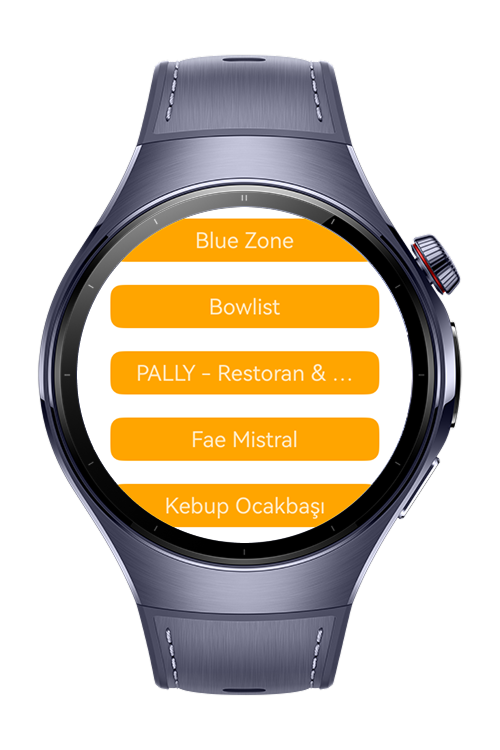
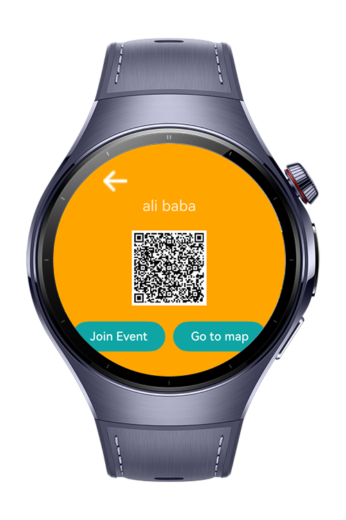
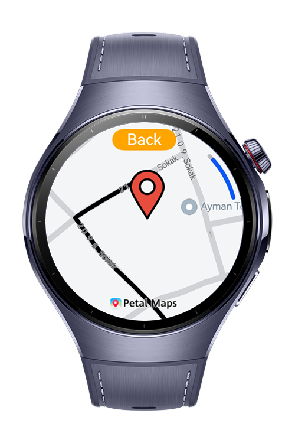

> **Note:** To access all shared projects, get information about environment setup, and view other guides, please visit [Explore-In-HMOS-Wearable Index](https://github.com/Explore-In-HMOS-Wearable/hmos-index).

# Event Snap

This app lists restaurants 5 km and gives you a way to go to events nearby. Just log in with the huawei account kit if
you're going to attend the event but you get a vibration after clicking on it

# Preview

<div style="display:flex;  align : left;">






</div>

# Use Cases

Users can use this application to find restaurants around them.

# Tech Stack

- **Languages**: ArkTS, ARKUI
- **Frameworks**: HarmonyOS SDK 5.1.0(18)
- **Tools**: DevEco Studio Vers 5.1.0.842
- **Libraries**:
    - @kit.ArkUI
    - @kit.MapKit
    - @kit.NotificationKit
    - @kit.BasicServicesKit
    - @kit.AbilityKit
    - @kit.ArkData
    - Nearby Service
    - @kit.AccountKit

# Directory Structure
```
├───component
│       EventCard.ets
│
├───entryability
│       EntryAbility.ets
│
├───entrybackupability
│       EntryBackupAbility.ets
│
├───model
│       EventModel.ets
│       LocationData.ets
│       UserInfo.ets
│
├───pages
│       EventDetail.ets
│       Index.ets
│       LoginPage.ets
│       MapPage.ets
│
├───service
│       LocationService.ets
│
├───utils
│       AccountKitUtils.ets
│       Constants.ets
│       LocationUtil.ets
│       Logger.ets
│       NotificationKitUtils.ets
│       PreferencesUtil.ets
│
└───viewmodel
AccountViewModel.ets

```

# Constraints and Restrictions

## Supported Devices

- Huawei Watch 5

# LICENSE

Event Snap is distributed under the terms of the MIT License.
See the [LICENSE](./LICENSE) for more information.